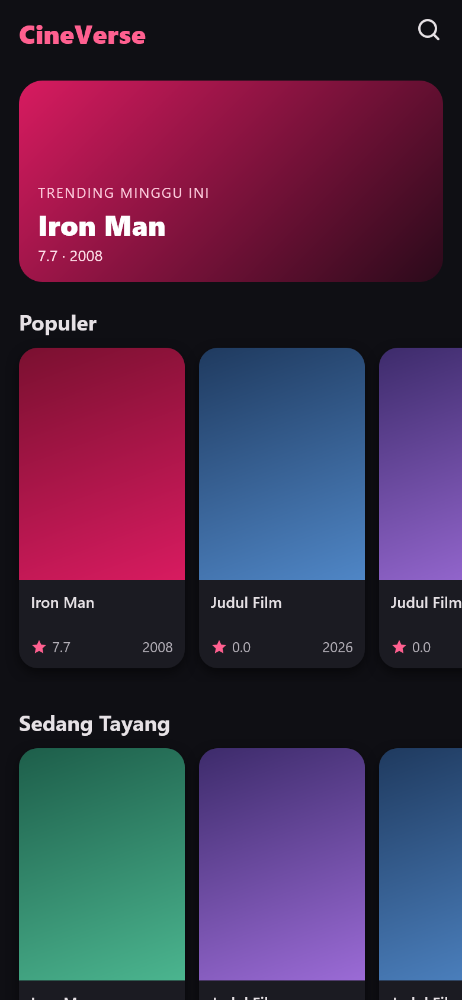
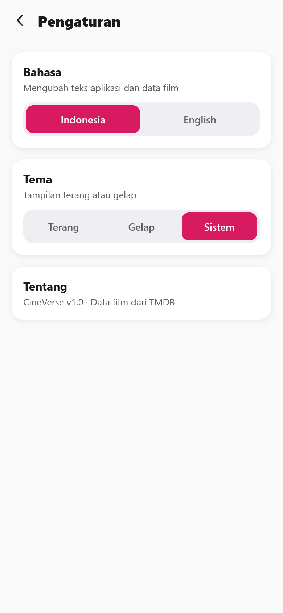

# CineVerse – Aplikasi Film Android

Aplikasi Android modern untuk menjelajahi katalog film populer, sedang tayang, rating tertinggi, dan trending minggu ini yang dibangun menggunakan **Jetpack Compose** dan terintegrasi dengan **The Movie Database (TMDB) API**. Dilengkapi dengan fitur personal library ala **Letterboxd** (Watchlist, Ditonton, Rating Bintang 1-5, dan Ulasan).

Dibuat untuk memenuhi kriteria penilaian **Project Pemrograman Mobile Kelas XII (November 2026)**.

---

## Tampilan Layar (Screenshots)

| Dashboard (Night Mode) | Dashboard (Not Night) | Halaman Detail Film | Halaman Pengaturan |
|:---:|:---:|:---:|:---:|
|  |  |  |  |

---

## Fitur Utama

### 1. Dashboard Interaktif (Bobot 30%)
- **Trending Banner**: Menampilkan film trending minggu ini dengan gradien rose/magenta yang elegan, judul tebal, rating bintang, dan tahun rilis.
- **Section Kategori**:
  - **Populer** (`/movie/popular`)
  - **Sedang Tayang** (`/movie/now_playing`)
  - **Rating Tertinggi** (`/movie/top_rated`)
- Scroll horizontal (`LazyRow`) yang responsif dan mulus.

### 2. Desain MovieCard Modern (Bobot 25%)
- Poster film beresolusi tinggi di-load dan di-cache secara otomatis oleh **Coil**.
- Sudut membulat (*rounded corners* 16dp) dengan elevasi Material 3.
- Informasi judul rapi dengan pemotongan teks (*ellipsis*), rating bintang (*star rating*), serta tahun rilis.

### 3. Multi Bahasa (Bobot 15%)
- Tersedia dalam **Bahasa Indonesia** dan **English**.
- Semua string UI dikelola terpusat melalui `res/values/strings.xml` dan `res/values-in/strings.xml`.
- Mengubah bahasa di halaman Pengaturan secara instan memperbarui teks antarmuka dan mengambil kembali data film dari TMDB menggunakan parameter `language=id-ID` atau `language=en-US`.

### 4. Mode Terang & Gelap / Night & Not Night
- Penerapan tema Material 3 menggunakan `lightColorScheme` dan `darkColorScheme`.
- Tiga opsi tema di halaman Pengaturan:
  - **Terang (Light Mode)**
  - **Gelap (Dark Mode)**
  - **Sistem (Mengikuti tema perangkat)**
- Palet warna konsisten: Aksen Crimson / Rose (`#E11D48`), Dark Surface (`#181A22`), Light Surface (`#FFFFFF`).

### 5. Dukungan Rotasi Layar (Portrait & Landscape)
- Seluruh layar dibungkus dalam container yang dapat di-scroll (`LazyColumn` dan `verticalScroll`).
- Orientasi layar dapat diubah (portrait / landscape) tanpa terjadi crash, tanpa pemotongan layout, dan status scroll tetap terjaga berkat arsitektur MVVM + `StateFlow`.

### 6. Fitur Personal Library ala Letterboxd (Watchlist, Watched, Rating, Review)
- **Watchlist (Ingin Ditonton)**: Simpan film yang ingin ditonton dengan satu sentuhan.
- **Watched (Ditonton)**: Tandai film yang sudah ditonton (otomatis tercentang saat memberi rating).
- **Interactive 1–5 Star Rating**: Beri rating bintang personal pada film favorit (klik bintang yang sama untuk reset rating).
- **Catatan Ulasan (Review)**: Tulis dan simpan ulasan pribadi untuk setiap film.
- **Layar Koleksi Saya (My Collection)**:
  - Header statistik ringkas ala Letterboxd (jumlah film ditonton & rata-rata rating).
  - Tab navigasi untuk filter **Watchlist** dan **Ditonton**.
  - Grid film adaptif responsif terhadap orientasi layar (`GridCells.Adaptive`).
- **Penyimpanan Lokal Persisten**: Disimpan secara lokal di perangkat menggunakan `SharedPreferences` + `Gson` sehingga data tidak hilang saat aplikasi ditutup atau dibuka kembali.

### 7. Halaman Detail Film & Pencarian
- **Detail Film**: Backdrop film resolusi tinggi, floating poster dengan elevasi, badge genre (*outlined chips*), sinopsis lengkap, tombol aksi Watchlist/Watched, rating bintang, dan form ulasan.
- **Pencarian Film**: Live search dengan debounce untuk mencari film favorit langsung dari TMDB.
- **Graceful Offline Fallback**: Tetap dapat menampilkan data demo offline jika koneksi internet terputus saat presentasi.

---

## Tech Stack & Library

- **Bahasa & UI**: Kotlin, Jetpack Compose, Material 3
- **Arsitektur**: MVVM (Model-View-ViewModel) + StateFlow
- **Networking**: Retrofit 2, OkHttp 4 (dengan Logging Interceptor), Gson
- **Image Loader**: Coil Compose
- **Navigasi**: Navigation Compose
- **Penyimpanan Lokal**: 
  - AndroidX DataStore Preferences (preferensi Tema dan Bahasa)
  - SharedPreferences + Gson (koleksi Watchlist, Ditonton, Rating, dan Review)

---

## Struktur Proyek

```text
com.athalia.cineverse/
├── MainActivity.kt                      # Activity utama & host Compose NavGraph
├── data/
│   ├── api/
│   │   ├── ApiClient.kt                 # Retrofit builder & OkHttp interceptor
│   │   └── TmdbApiService.kt            # Interface endpoint TMDB
│   ├── model/
│   │   ├── MovieModels.kt               # Movie, MovieDetail, MovieResponse, Genre
│   │   └── SavedMovie.kt                # Model data Watchlist, Watched, Rating & Review
│   └── repository/
│       ├── LibraryRepository.kt         # Penyimpanan lokal koleksi film (SharedPreferences + Gson)
│       ├── MovieRepository.kt           # Repository pengambilan data API & fallback
│       └── UserPreferencesRepository.kt # DataStore preferensi tema & bahasa
├── ui/
│   ├── components/
│   │   ├── CategorySection.kt           # Section horizontal daftar film
│   │   ├── CommonStates.kt              # LoadingState & ErrorState
│   │   ├── GenreChip.kt                 # Chip genre bergaris luar
│   │   ├── MovieCard.kt                 # Card film dengan poster & rating
│   │   ├── RatingBar.kt                 # Komponen bintang interaktif 1..5
│   │   └── TrendingBanner.kt            # Banner hero film trending
│   ├── navigation/
│   │   ├── AppNavGraph.kt               # NavHost navigasi Compose
│   │   └── Screen.kt                    # Rute navigasi (Dashboard, Detail, Settings, Search, Collection)
│   ├── screens/
│   │   ├── CollectionScreen.kt          # Layar Koleksi Saya (Watchlist & Watched)
│   │   ├── DashboardScreen.kt           # Layar utama
│   │   ├── DetailScreen.kt              # Layar detail film & ulasan
│   │   ├── SearchScreen.kt              # Layar pencarian film
│   │   └── SettingsScreen.kt            # Layar pengaturan bahasa & tema
│   └── theme/
│       ├── Color.kt                     # Palet warna Light & Dark
│       ├── Theme.kt                     # CineVerseTheme (Material 3)
│       └── Type.kt                      # Tipografi
├── util/
│   └── LocaleHelper.kt                  # Utilitas pergantian locale bahasa aplikasi
└── viewmodel/
    ├── LibraryViewModel.kt
    ├── MovieDetailViewModel.kt
    ├── MovieViewModel.kt
    ├── SearchViewModel.kt
    ├── SettingsViewModel.kt
    └── ViewModelFactory.kt
```

---

## Konfigurasi TMDB API Key

API Key disimpan di dalam file `local.properties` (dan otomatis diabaikan oleh `.gitignore` sehingga aman tidak terunggah ke repositori publik):

1. Buka atau buat file `local.properties` di direktori *root* proyek.
2. Tambahkan baris berikut:
   ```properties
   TMDB_API_KEY=
   ```
3. Gradle akan membaca kunci ini dan menyediakannya melalui `BuildConfig.TMDB_API_KEY`.

---

## Alur Demo Presentasi

1. **Dashboard & Kategori**: Buka dashboard, perhatikan trending banner dan scroll horizontal kategori Populer, Sedang Tayang, dan Rating Tertinggi.
2. **Detail Film & Letterboxd**:
   - Ketuk salah satu card film untuk membuka layar Detail.
   - Ketuk tombol **Ingin Ditonton (Watchlist)** dan/atau **Ditonton**.
   - Berikan **Rating Bintang (1–5)** dan ketik ulasan pribadi, lalu tekan **Simpan**.
3. **Koleksi Saya (My Collection)**:
   - Kembali ke Dashboard, tekan ikon Koleksi di toolbar kanan atas.
   - Lihat statistik jumlah film ditonton dan rata-rata rating yang diperbarui otomatis.
   - Pindah antar tab **Ingin Ditonton** dan **Ditonton**.
4. **Persistensi Data**: Tutup aplikasi dan buka kembali; data koleksi dan rating tetap tersimpan.
5. **Multi Bahasa & Tema**:
   - Buka Pengaturan, ubah bahasa ke English (UI dan data TMDB beralih ke bahasa Inggris).
   - Ubah tema ke Gelap (Night Mode) atau Terang (Light Mode).
6. **Rotasi Layar**: Putar perangkat ke mode Landscape di layar Dashboard, Detail, dan Koleksi; layout beradaptasi dengan responsif tanpa crash.

---

## Cara Menjalankan Aplikasi

1. Clone repositori ini:
   ```bash
   git clone https://github.com/athaliacalya/CineVerse.git
   cd CineVerse
   ```
2. Pastikan file `local.properties` memiliki `sdk.dir` dan `TMDB_API_KEY`.
3. Buka proyek di **Android Studio**.
4. Lakukan sinkronisasi Gradle (*Sync Project with Gradle Files*).
5. Jalankan aplikasi di emulator Android atau perangkat fisik:
   ```bash
   ./gradlew assembleDebug
   ```
6. File APK debug hasil kompilasi tersedia di:
   `app/build/outputs/apk/debug/app-debug.apk`

---

## Pemetaan Rubrik Penilaian

| Kriteria | Bobot | Implementasi di CineVerse |
|:---|:---:|:---|
| **Desain Dashboard** | 30% | Banner trending minggu ini dengan gradien rose, kategori Populer, Sedang Tayang, Top Rated, tipografi dan warna konsisten sesuai mockup |
| **Desain Card** | 25% | Poster proporsional, sudut membulat 16dp, elevasi Material 3, judul rapi dengan ellipsis, rating bintang merah/pink dan tahun |
| **Multi Bahasa** | 15% | Tersedia Bahasa Indonesia (`values-in`) dan English (`values`), dapat diganti secara langsung dari Pengaturan, memperbarui UI dan parameter API |
| **Presentasi & Fungsi** | 30% | Demo alur data Retrofit/TMDB, fitur personal library Letterboxd, ganti tema Terang/Gelap/Sistem instan, rotasi layar portrait/landscape mulus tanpa crash |
